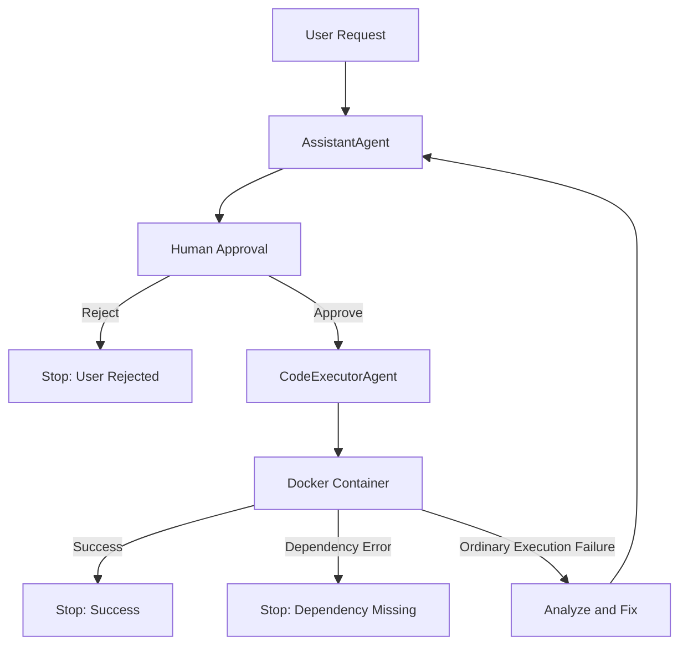

# AI Python Code Builder & Executor

A human-in-the-loop multi-agent workflow built with Microsoft AutoGen that generates Python code, requires explicit human approval before execution, runs code inside an isolated Docker container, and automatically corrects failed executions.

> **Generate → Review → Execute → Fix → Review → Execute**

This project demonstrates how AI-generated code can be combined with human-in-the-loop approval, sandboxed execution, and feedback-driven refinement.

## Why This Project?
AI models can generate useful code, but generated code is not always correct, safe, or ready for execution.

This project explores a controlled workflow where:

* AI generates Python code
* A human explicitly approves execution
* Code runs inside Docker containers
* Execution errors are analyzed
* AI generates corrected versions
* Every correction requires fresh approval

The goal is not simply code generation, but designing an iterative execution workflow with validation and human oversight.

## Key Features

* 🤖 AI-powered Python code generation
* 👨‍💻 Human-in-the-loop approval
* 🐳 Docker-based sandboxed execution
* 🔄 Automatic error correction
* 🛑 Configurable retry limits
* ⚡ Execution success detection
* 🧩 AutoGen `RoundRobinGroupChat` orchestration
* 🔒 Security-aware execution model
* ✅ Unit tests

## Architecture


### Agent Responsibilities

| Component         | Responsibility                   |
| ----------------- | -------------------------------- |
| AssistantAgent    | Generate and correct Python code |
| approval_func     | Human approval                   |
| CodeExecutorAgent | Execute approved code            |
| Docker            | Isolated execution environment   |
| Termination Logic | Control workflow lifecycle       |

## Example Workflow

### User Request
The user provides a Python-related task.

```text
Create a Python program that calculates the factorial of 10.
```

### Code Generation
The `AssistantAgent` generates executable Python code.

```python
def factorial(n):
    result = 1
    for i in range(1, n + 1):
        result *= i
    return result

print(factorial(10))
```

### Human Approval
Before execution, the user sees a code preview and explicitly approves or rejects the execution.

Large generated programs are truncated in the CLI preview for readability, while the complete code is passed to the executor.

```text
============================================================
 CODE EXECUTION APPROVAL
============================================================

Generated Python code:
------------------------------------------------------------
# filename: calculate_factorial.py
number = 10

def factorial(n):
    if n == 0:
        return 1
    return n * factorial(n - 1)

print(factorial(number))
------------------------------------------------------------
Total lines: 7

Execute this code?

[y] Yes, execute
[n] No, reject

Your choice:
```

### Code Execution
Approved code is executed by `CodeExecutorAgent` using `DockerCommandLineCodeExecutor`.

The code therefore runs inside a Docker container rather than directly in the application's host Python process.

### Successful Execution

If execution succeeds, the output is shown:

```text
EXECUTOR
------------------------------------------------------------
3628800
```

### Failed execution

If execution fails:

```text
NameError: variable 'number' is not defined
```

The error is returned to `AssistantAgent`.

The assistant generates corrected code.

Human approval is required again.

### Termination
Workflow stops when:

* Execution succeeds:
```text
============================================================
                    TERMINATION
============================================================

Code execution completed successfully.
```
* User rejects execution
```text
============================================================
                    TERMINATION
============================================================

Code execution was rejected by the user.
```
* Dependency missing
```text
============================================================
                    TERMINATION
============================================================

Execution stopped because a required dependency is missing or could not be loaded.
The original program was not replaced with a placeholder. Resolve the dependency in the Docker environment before retrying.
```
* Maximum failure count is reached
```text
============================================================
                    TERMINATION
============================================================

Maximum failed execution count reached: 3.
```

## Design Principles

### 1. Separation of concerns

`AssistantAgent` generates and fixes Python code, while `CodeExecutorAgent` handles execution approval and code execution. Docker provides the execution environment.

### 2. Human approval before every execution

No generated or corrected code is executed without explicit human approval. Approval is an execution control, not a substitute for sandboxing.

### 3. Isolated execution

Approved code runs inside Docker rather than directly in the application's host Python process.

### 4. Bounded execution

The workflow terminates when execution succeeds, the maximum number of failed executions is reached, or the overall `MAX_TURNS` limit is reached.

### 5. Minimal abstraction

The project avoids additional agents and custom infrastructure unless they provide a clear benefit to the current workflow.

## Human-in-the-Loop

Human approval is implemented through `CodeExecutorAgent`'s `approval_func`.

```python
executor = CodeExecutorAgent(
    name="executor",
    code_executor=code_executor,
    approval_func=approval_func,
)
```

The approval function receives the code that is about to be executed and allows the user to approve or reject it.

```python
def approval_func(request) -> ApprovalResponse:
    ...
```

```text
[y] Yes, execute
[n] No, reject
```

Every newly generated or corrected version requires fresh approval.

### Why `approval_func` instead of `UserProxyAgent`?

`UserProxyAgent` is useful when a human participates in the agent conversation, such as answering clarification questions or providing additional input.

In this project, the human has a narrower responsibility: approving or rejecting code execution. Using `approval_func` keeps this interaction explicit without introducing another conversational participant.

## Why `CodeExecutorAgent` Has No Model Client

The executor is intentionally created without a model client:

```python
executor = CodeExecutorAgent(
    name="executor",
    code_executor=code_executor,
    approval_func=approval_func,
)
```

The responsibilities are separated as follows:

| Component           | Responsibility                    |
| ------------------- | --------------------------------- |
| `AssistantAgent`    | Generate and fix Python code      |
| `CodeExecutorAgent` | Obtain approval and execute code  |
| Docker              | Provide the execution environment |

All LLM-based reasoning belongs to `AssistantAgent`. The executor focuses on execution, avoiding duplicated reasoning responsibilities.

## Implementation Notes: AutoGen 0.7.5

### Execution Result Classification

In AutoGen 0.7.5, the `CodeExecutorAgent` is used without a model client, so the workflow interprets the executor's `TextMessage` output rather than relying on `CodeExecutionEvent.result.exit_code`.

A centralized `get_executor_status()` function classifies executor messages into four statuses:

- `SUCCESS`: Execution completed successfully.
- `FAILURE`: Execution failed and may be retried.
- `REJECTED`: The user declined execution.
- `DEPENDENCY_ERROR`: A required dependency is missing
  or could not be loaded.

The `ExecutorStatus` enum provides a single source of truth for status classification. Termination conditions and failure counting use this classification rather than independently interpreting executor messages.

This is a lightweight implementation trade-off. Because status detection relies on message text, it is less robust than consuming structured execution results. Changes in output formatting or unhandled error types may require further adaptation.

## Termination Strategy

The workflow terminates when one of the following conditions is met:

- **Successful execution:** The generated Python code executes successfully.
- **User rejection:** The user declines to approve code execution.
- **Dependency error:** A missing or unloadable dependency is detected, and the workflow stops without automatically installing packages.
- **Maximum failed executions:** The configured limit of consecutive failed execution attempts is reached.
- **Maximum turns:** The overall conversation turn limit is reached.

The default `MAX_FAILED_EXECUTIONS` value is `3`.

Dependency errors are handled separately from ordinary code execution failures. The current implementation does not automatically install missing dependencies or provision specialized runtime environments.

### Successful execution

```python
successful_execution = FunctionalTermination(
    is_executor_result_successful
)
```

### Rejected execution

```python
rejection_termination = FunctionalTermination(
    is_executor_result_rejected
)
```

### Dependency missing execution

```python
dependency_termination = FunctionalTermination(
    is_executor_result_dependency_error
)
```

### Maximum failed executions

```python
max_failures_termination = MaxExecutionFailuresTermination(
    max_failed_executions=MAX_FAILED_EXECUTIONS
)
```

### Combined termination

```python
termination = (
    successful_execution
    | rejection_termination
    | dependency_termination
    | max_failures_termination
)
```

The default `MAX_FAILED_EXECUTIONS` value is `3`.

```text
Execution #1 → Failed
Execution #2 → Failed
Execution #3 → Failed
                  │
                  ▼
                 Stop
```

`MAX_FAILED_EXECUTIONS` and `MAX_TURNS` serve different purposes:

| Limit                   | Responsibility                                |
| ----------------------- | --------------------------------------------- |
| `MAX_FAILED_EXECUTIONS` | Limits repeated execution failures            |
| `MAX_TURNS`             | Provides an overall conversation safety limit |

This combination prevents unbounded correction loops.

## Security Model

The project deliberately separates code generation from code execution.

```text
AI-generated Python
        │
        ▼
Human approval
        │
        ▼
Docker container
        │
        ▼
Execution result
```

Docker provides an additional isolation boundary, but it should **not** be considered an absolute security guarantee. Human approval is a workflow control, not a substitute for sandboxing.

This project is intended as a development and demonstration project, not a hardened production sandbox for arbitrary hostile code.

Production environments may require additional controls, including:

* CPU and memory limits
* Execution timeouts
* Network restrictions
* Read-only filesystems
* Non-root execution
* Seccomp/AppArmor policies
* Dedicated sandbox infrastructure

## Technology Stack

| Component       | Technology          |
| --------------- | ------------------- |
| Agent Framework | Microsoft AutoGen   |
| Orchestration   | RoundRobinGroupChat |
| LLM             | OpenAI GPT Models   |
| Execution       | Docker              |
| Language        | Python              |
| Testing         | pytest              |

## Project Structure

```text
ai-python-code-builder-executor/
│
├── app/
│   ├── code_builder.py
│   ├── config.py
│   ├── prompts.py
│   └── termination_conditions.py
│
├── tests/
│   └── test_termination_conditions.py
│
├── working/
│   └── .gitkeep
│
├── .env.example
├── .gitignore
├── requirements.txt
└── README.md
```

## Configuration

Configuration is stored in `.env`.

Example:

```env
OPENAI_API_KEY=your_api_key_here

OPENAI_MODEL=gpt-4o-mini
CODE_WORK_DIR=working

CODE_PREVIEW_MAX_LINES=50
CODE_PREVIEW_HEAD_LINES=25
CODE_PREVIEW_TAIL_LINES=25

MAX_FAILED_EXECUTIONS=3
MAX_TURNS=12
```

## Installation

Create a virtual environment and install the required dependencies.

```bash
python -m venv .venv
```

Activate the environment on Windows:

```powershell
.venv\Scripts\Activate.ps1
```

Install the dependencies:

```bash
pip install -r requirements.txt
```

## Running

Start Docker Desktop, then run:

```bash
python app/code_builder.py
```

The application starts with:

```text
============================================================
              AI PYTHON CODE BUILDER
============================================================

What Python program would you like to build?
>
```

Enter a natural-language Python task.

For example:

```text
Create a Python program that calculates the factorial of 10.
```

The assistant generates the code and waits for human approval before execution.

## Testing

Run the test suite with:

```powershell
python -m pytest
```

The unit tests cover executor result classification and the
custom termination logic, including success, ordinary failures,
user rejection, dependency errors, failure limits, and reset behavior.

These tests validate the classification and termination components
independently; they do not constitute a full end-to-end test of
the OpenAI model, Docker runtime, and interactive approval workflow.

## Key Agentic AI Concepts

* Multi-agent workflows
* Human-in-the-loop AI
* Tool calling
* Docker sandboxing
* Execution validation
* Automatic correction
* Feedback-driven refinement
* Retry strategies
* Termination conditions
* Separation of concerns

## Limitations

* The workflow currently supports Python only
* Human approval is required
* Generated code quality depends on the LLM
* Docker is not a complete security boundary
* The Docker runtime uses its configured environment; specialized dependencies may require additional setup.
* Missing dependencies are detected, but packages are not installed automatically.
* Interactive graphical applications are not currently presented through a dedicated GUI or browser interface.
* Generated code artifacts from failed attempts may remain in the working directory; automatic cleanup is not currently implemented.

This project is a proof of concept for controlled AI-generated code execution, not a fully managed runtime environment for every Python application.

## Future Improvements

* Support multiple programming languages
* Add execution history
* Add code quality evaluation
* Support multiple LLM providers
* Add web interface
* Add advanced sandboxing

## License

This project is licensed under the MIT License.
